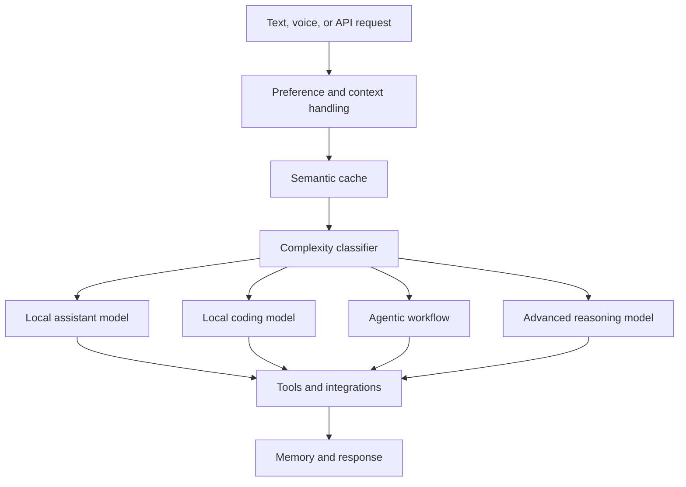

# Azarath

**A local-first AI assistant for macOS**

Azarath combines local language models, voice interaction, screen understanding,
system automation, memory, and multi-platform access in one assistant. It is
designed to keep routine requests on-device while escalating only the work that
needs a more capable model.

> **Showcase repository:** This repository contains project documentation and
> media only. The source code is maintained privately and is not distributed.

## Highlights

- **Tiered AI routing** — sends each request to an appropriate model based on
  complexity, with escalation when a task cannot be completed.
- **macOS automation** — controls applications and common system settings.
- **Screen understanding** — reads interface context, identifies controls, and
  supports guided interaction.
- **Voice interaction** — speech-to-text, interruptible text-to-speech, and
  voice activity detection.
- **Agentic workflows** — plans multi-step tasks, executes them, retries failed
  steps, and supports rollback for reversible actions.
- **Long-term memory** — stores conversations and preferences and retrieves
  relevant context when needed.
- **Browser and app integrations** — supports browser operations, Spotify,
  Calendar, Reminders, Notes, and Mail.
- **Multi-platform API** — exposes the assistant through an HTTP API for chat
  and messaging integrations.

## Architecture

The routing layer favors local models for everyday requests. More complex work
can move through coding, agentic, or advanced reasoning paths while sharing the
same tools, integrations, and memory.

## Capabilities

### Local AI

- Complexity-aware model selection
- Automatic escalation and local fallback
- Semantic response caching
- Dynamic tool discovery

### Desktop and screen

- Application and window management
- Volume, brightness, Wi-Fi, Bluetooth, and appearance controls
- Accessibility-based interface reading
- Vision-assisted screen analysis and interaction

### Productivity

- Timers and alarms
- Clipboard and notification tools
- Calendar, Reminders, Notes, and Mail integrations
- Browser and Spotify controls

### Engineering workflows

- Multi-step planning and execution
- Parallel task workers
- Automated lint and test gates
- Review and correction loops

## Technology

- Python 3.11+
- Ollama and local language/vision models
- FastAPI
- SQLite and LanceDB
- Whisper speech recognition
- macOS Accessibility APIs and AppleScript

## Media

Screenshots and demo recordings will be published in [`assets/`](assets/) as
they become available.

## Project status

Azarath is an independently developed project under active development. This
public repository is intended as a product and engineering showcase; it is not
an installable source distribution.

## Questions and feedback

Use this repository's GitHub Issues page for general questions and feedback.
Please do not submit requests for private source code or redistribution rights.

## Source and licensing

The Azarath source code is proprietary and maintained in a private repository.
No license to use, copy, modify, or redistribute that source code is granted by
this showcase. See [NOTICE.md](NOTICE.md).
